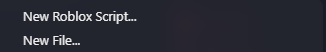
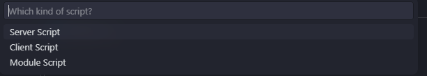
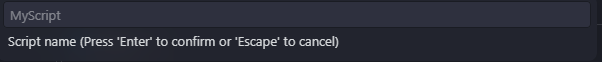
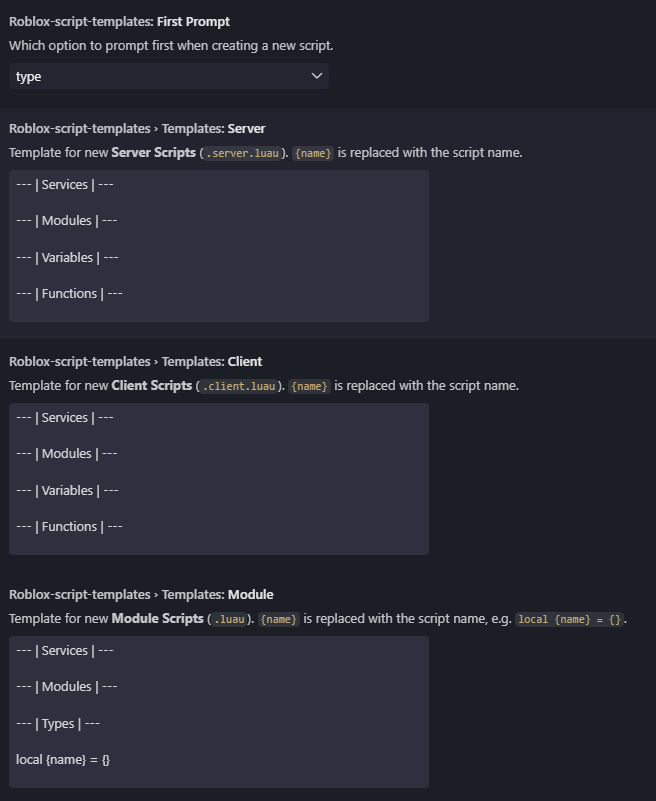

# Roblox Script Templates

Create Roblox scripts from your own templates, right from the VS Code explorer.



## Usage

1. Right-click a folder or file in the explorer and choose **New Roblox Script...**
2. Pick the script type.
3. Enter a name.





The file is created with the matching extension and opened right away:

| Type          | File               |
| ------------- | ------------------ |
| Server Script | `Name.server.luau` |
| Client Script | `Name.client.luau` |
| Module Script | `Name.luau`        |

The file names follow the [Rojo](https://rojo.space/) conventions.

- Right-clicking a file creates the script next to that file.
- Running the command from the Command Palette creates the script in the first workspace folder.
- Existing files are never overwritten.

### Script names

Names may only contain letters, digits and `_`, and must not start with a digit. This keeps every name a valid Luau identifier, so `local {name} = {}` in a module always works. Don't type the file extension, it is added for you.

## Settings

| Setting                                    | Default | Description                                     |
| ------------------------------------------ | ------- | ----------------------------------------------- |
| `roblox-script-templates.firstPrompt`      | `type`  | Ask for the script `type` or the `name` first.  |
| `roblox-script-templates.templates.server` | *       | Template for server scripts.                    |
| `roblox-script-templates.templates.client` | *       | Template for client scripts.                    |
| `roblox-script-templates.templates.module` | *       | Template for module scripts.                    |

\* Section comments, see below.

Templates are edited as multi-line text in the Settings UI. `{name}` is replaced with the script name.



Default module template:

```lua
--- | Services | ---

--- | Modules | ---

--- | Types | ---

local {name} = {}

return {name}
```

The server and client templates contain the Services, Modules, Variables and Functions sections.

## Requirements

VS Code 1.74 or newer.

## License

[MIT](LICENSE)
